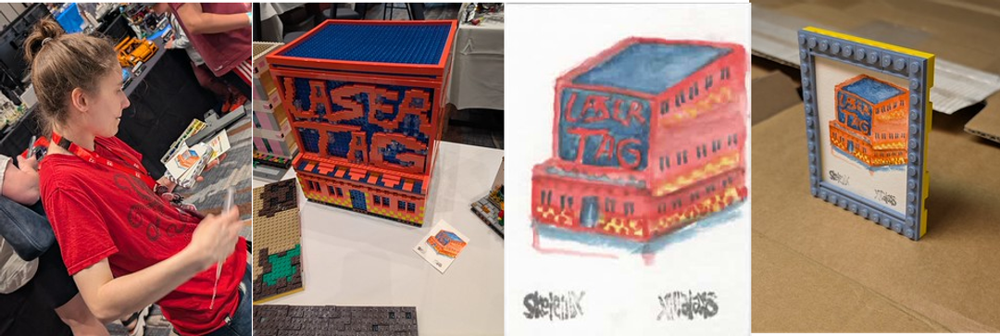
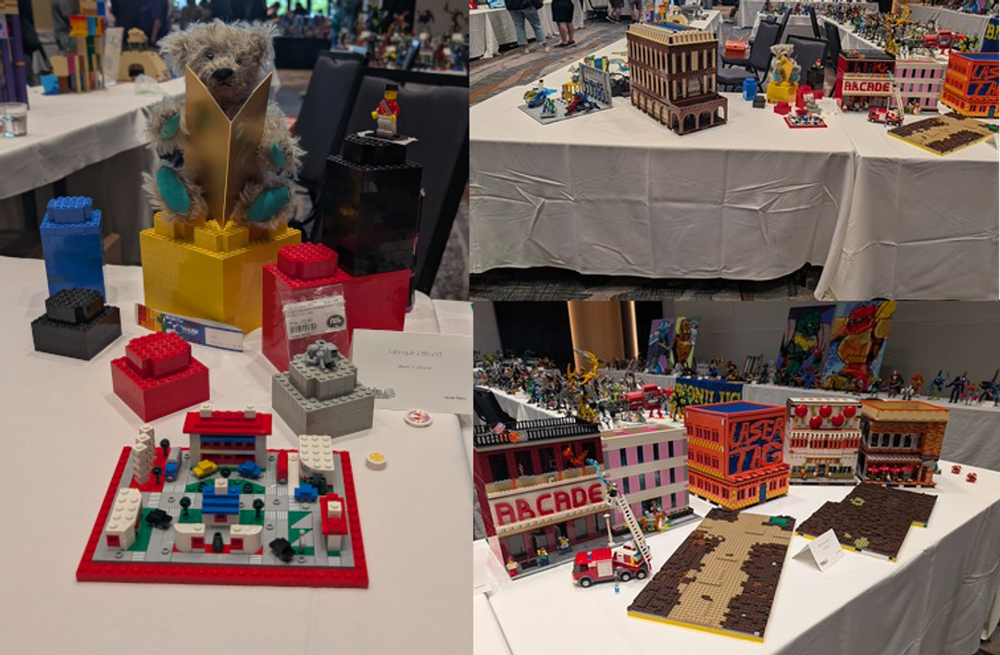
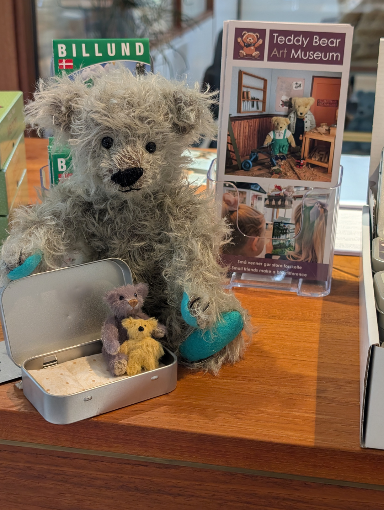
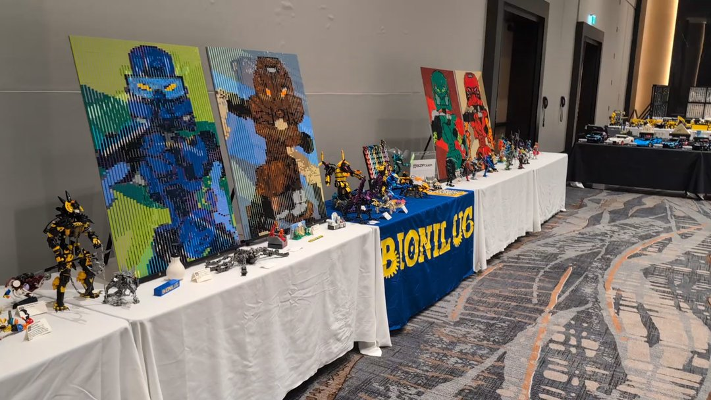
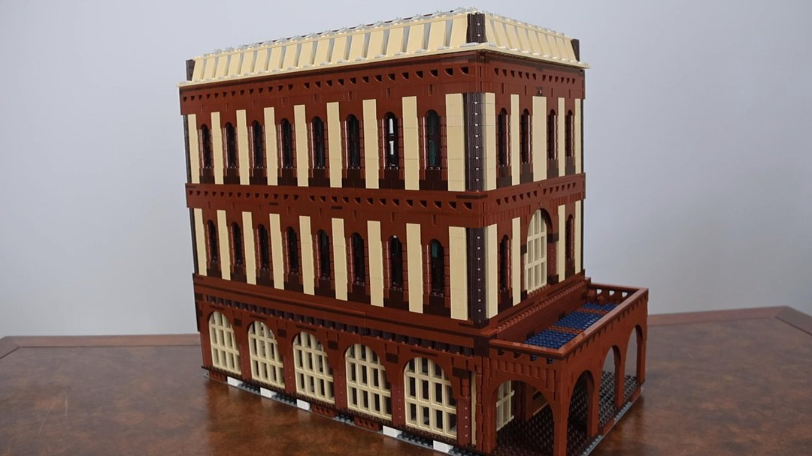
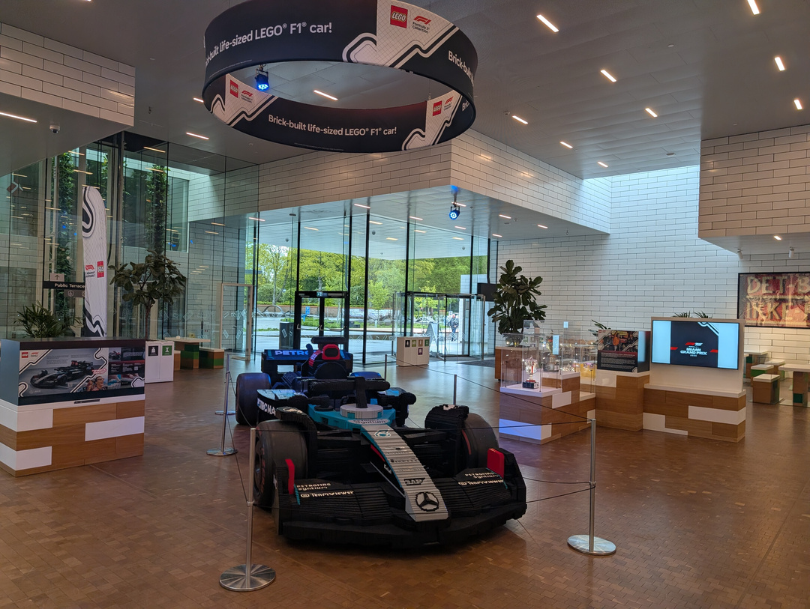
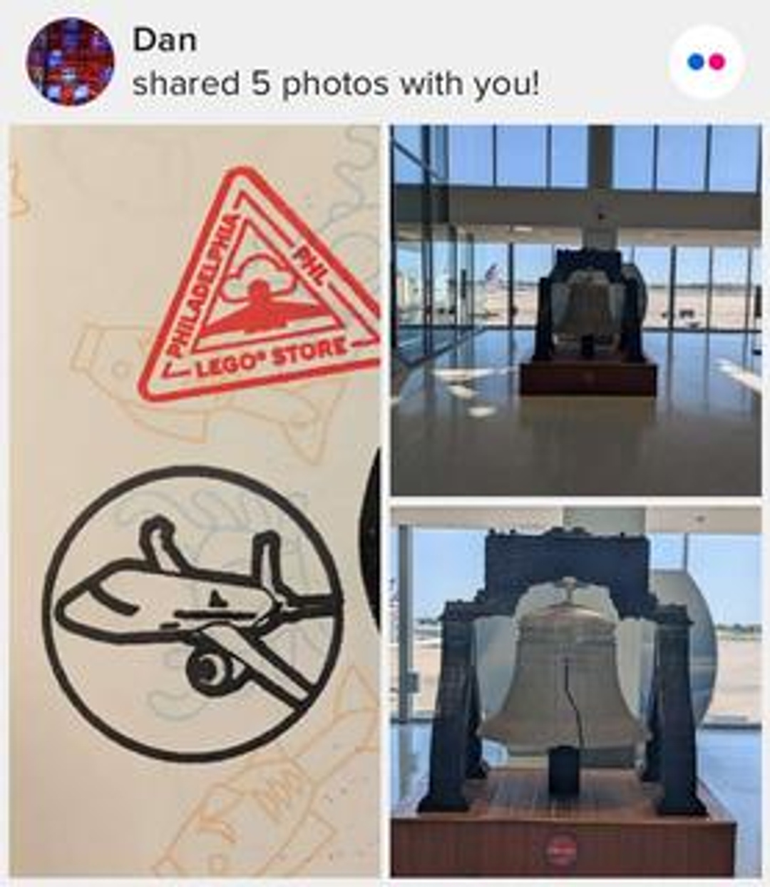

# Patreon Quips

Public quips from [Dan Pikora's Patreon Quips page](https://www.patreon.com/cw/DanPikora/quips), collected October 20, 2026. Entries are listed newest first; Patreon displayed the newest entry as “Yesterday” when collected.

## October 19, 2026

[Patreon quip](https://www.patreon.com/DanPikora/posts/172821218)

Do you have a YouTube channel with a video of one of your original MOCs on it? Let me know!

A little while back, I started a YouTube Playlist: https://www.youtube.com/playlist?list=PLfMtNEjePOdU titled "Real AFOLs Real MOCs" - the goal being to highlight people who build. There are plenty of people who provide commentary, review sets, visit events, etc, but they're not the artists we want to celebrate. Even the word "artist" is probably making the bar sound too high - you qualify as a real AFOL with with a real MOC as soon as you've shared something original you've made out of LEGO elements.  
  
My self-imposed rules for this YouTube playlist:  
- one MOC per builder to highlight accounts we should follow (implied here: it should be your video of your MOC)

- building/models only

## October 13, 2026

[Patreon quip](https://www.patreon.com/DanPikora/posts/172206905)

While I was at Brickomanie this year, I encountered Knifex Skelenby ( https://skelenby.neocities.org/ ) as they painted my Laser Tag building! I've since built a small frame for the finished painting, which was left next to my model when it was complete. Besides the collage featured here, there are seven phone snapshots of the process (spanning their painting, the results, and my framing) newly public on Flickr: https://www.flickr.com/photos/dp3/albums/72177720335524563/

## October 11, 2026

[Patreon quip](https://www.patreon.com/DanPikora/posts/172017846)

Newly on Flickr (and completely public)! 5 phone snapshots (and this collage) showing my personal display at Brickomanie 2026:  https://www.flickr.com/photos/dp3/albums/72177720335521286/

## September 16, 2026

[Patreon quip](https://www.patreon.com/DanPikora/posts/169750455)

(copied from Flickr, where I do a Teddy Bear Tuesday feature weekly every Tuesday)  
  
This Teddy Bear Tuesday, I've started uploading and sorting my remaining phone snapshots from June 13th-14th, 2026 - the days I took the Teddy Bear Sewing Course at the Billund, Denmark's beautiful Teddy Bear Art Museum.  
  
After the course on Sunday, I picked up two additional tiny bears made by the course's instructor, Martha Baasch ( www.instagram.com/metha_bears ). I shared a little more about her, the lavender-colored bear (Pelle), and Pelle's even tinier friend back in July: https://www.flickr.com/photos/dp3/55379831382/  
  
I previously shared (but apparently <i>not</i> in the Teddy Bear Tuesday groups) a photo on June 14th when I first finished my bear:  
https://www.flickr.com/photos/dp3/55335082984/in/album-72177720334187410  
  
...and I've also shared one &quot;around town shenanigan&quot; photo before, from the giant LEGO bricks outside LEGO House: https://www.flickr.com/photos/dp3/55443915375/in/album-72177720335652958  
  
...but this picture on the front desk of the museum was actually the beginning of a whole series of photos I took around town with these young bears - they had to see the highlights of their hometown before I took them &quot;across the pond&quot; to the States!  
  
I may make more of those public soon - especially if there's popular demand to see the bears pose for photos around town, or the making of my bear with teal paws. Until I get a chance to finish adding descriptions to those 51 photos, they're exclusive as a preview to Members of my Patreon.

## September 8, 2026

[Patreon quip](https://www.patreon.com/DanPikora/posts/pxl-20251003-168986444)

I've updated my Patreon Header image! One of my more popular MOCs from the past few years is my Riverwalk District, which was originally built for Charm City LUG's City collaborative at BrickFair VA in 2025. After that first event, I cut the landscape in half and swapped out a few of the buildings, allowing me to show best-of highlights from three different years of collaborative displays with Charm City LUG:  
- concert pavilion, mermaid band, and decorative coral are from the mermaid-flavored coral reef collaborative in 2023  
- the medium nougat skyscraper (less than half the original height appears here) with glowy and art-deco accents came from a lightly cyberpunk city layout in 2024  
- the sand blue building, riverwalk landscaping, and rubber duck race came from the 2025 city layout  
  
The full photo (with links to relevant albums) is public on Flickr: https://www.flickr.com/photos/dp3/54842171904/

## September 6, 2026

[Patreon quip](https://www.patreon.com/DanPikora/posts/168784011)

I've put together a post recounting the process of memorializing BrickJournal editor Joe Meno's Flickr account. His 63,481 public photos will now be kept online indefinitely.

## September 6, 2026

[Patreon quip](https://www.patreon.com/DanPikora/posts/lego-house-cars-168783631)

Considering that I've been the LEGO hobby community's primary source for information on a rare exclusive set from June's LEGO House Cars Designer Evening, I've been surprised how little attention my photos of the set have gotten. Since I hadn't posted about it on Patreon yet, here's a link to the photos shared so far:  
  
https://www.flickr.com/photos/dp3/albums/72177720334195919/

## August 26, 2026

[Patreon quip](https://www.patreon.com/DanPikora/posts/img-8306-167709057)

I stumbled across this while looking up an older MOC earlier... I think this might be the least amount of views I have on a photo of a decent MOC (undoubtedly because it got buried in other LEGOLAND photos) https://www.flickr.com/photos/dp3/30586298420/in/album-72157627265274741/  

There was a build challenge at the time to "Build a Pirate model to join MetalBeard's Crew". That LEGO Movie-based theme lines up with the beheaded robot and Space Police-ish prison that this Miniland-scale pirate has evaded.

My entire archive of LEGOLAND Florida photos is publicly available for free.

Check out more on Flickr directly: https://www.flickr.com/photos/dp3/collections/72157724814470991 

...or use my sitemap tool for easier navigation: https://danny316p.github.io/flickr-sitemap.html?q=legoland+florida

## August 22, 2026

[Patreon quip](https://www.patreon.com/DanPikora/posts/167350832)

A quick look at the BioniLUG display I've set up at Brickomanie 

## July 20, 2026

[Patreon quip](https://www.patreon.com/DanPikora/posts/164296878)

I built this hotel for ColonialLUG's Beach Town collaborative build in 2026. I made three other buildings for that beach/summer-themed LEGO town layout as well, but only this one has easily-removable floors, a folding middle section, and the beginnings of an interior.

Added to YouTube and now Patreon by popular demand! I want to add more to this building yet, but public attendees of Maker Faire Philadelphia saw me showing off these features and insisted that I get video of it.

See behind-the-scenes photos of my build process on Flickr (and even more photos of that process are available to my Patreon supporters): https://www.flickr.com/photos/dp3/albums/72177720330792847/ (title was MVI 0939)

## July 13, 2026

[Patreon quip](https://www.patreon.com/DanPikora/posts/bzpower-is-much-163647914)

I've posted an unusual tidbit on BZPower just now: https://www.bzpower.com/blogs/entry/139267-bzpower-is-much-more-active-than-i-thought/ - the long and short of it is that I was surprised to find that my "form letter" announcing my Billund trip (and blasted out to many people and social platforms) actually got the best response as a BZPower blog entry.

## June 18, 2026

[Patreon quip](https://www.patreon.com/DanPikora/posts/161410155)

LEGO House just added a bunch of new merch today!  
https://www.flickr.com/photos/dp3/shares/jzi1313Q5K

## June 16, 2026

[Patreon quip](https://www.patreon.com/DanPikora/posts/dan-has-shared-4-161266206)

I took way too long to figure out that I could just order takeout from Billund's Pizza Steakhouse.  
  
Calzone  
41. Billund  
Pizzasauce, ost, skinke, spaghetti, kødsauce  
https://www.flickr.com/photos/dp3/shares/J1G0A14790

## May 31, 2026

[Patreon quip](https://www.patreon.com/DanPikora/posts/dan-flickr-159701531)

With the massive Billund trip continuing to occupy my time, I have not had a chance to finish sorting Le Sommet de la Brique photos to put in the tiers. They will likely pop up in June - so there's no "New Access" post coming for May.  
  
There is a smattering of new phone snapshots popping up on Flickr during the trip, and there are 1,233 photos across 21 albums that I uploaded shortly before leaving covering the 2026 Philadelphia Doll & Teddy Bear Convention. You can use my sitemap tool ( https://danny316p.github.io/flickr-sitemap.html ) for easy navigation of everything up to that convention.

## May 31, 2026

[Patreon quip](https://www.patreon.com/DanPikora/posts/dan-has-shared-7-159701507)

More sculptures at LEGOLAND Billund Wilderness Campground. I want to check if these Ninjago characters match the ones at the parks...  
https://www.flickr.com/photos/dp3/shares/0uF5z8162f

## May 26, 2026

[Patreon quip](https://www.patreon.com/DanPikora/posts/dan-has-shared-5-159321710)

I splurged and dug in to a proper three-course menu at LEGOLAND Billund's LEGOLAND Hotel Panorama Restaurant. Descriptions of each course (and the pretty round of focaccia) are on each photo's page on Flickr.  
https://www.flickr.com/photos/dp3/shares/5eJw7N51NU

## May 19, 2026

[Patreon quip](https://www.patreon.com/DanPikora/posts/dan-has-shared-6-158719826)

I've checked in to my park view room for my Inside Tour! It does, in fact, provide a gorgeous view of the park. The rooms feel positively surreal, like opening the door to step out onto Solaris.  
 Don't miss the 360° shot of me grabbing an overhead view of the park/selfie where I don't fall to my death!  https://www.flickr.com/photos/dp3/shares/Lw2HksvPLo

## May 19, 2026

[Patreon quip](https://www.patreon.com/DanPikora/posts/pxl-20260507-158718820)

https://flic.kr/p/2sdWkQb Happy Teddy Bear Tuesday from beautiful Billund, Denmark! You can do a double-take here - if you've followed me on Flickr for a while, you likely know I have a lifesize Muffy at home (see <a href="https://flic.kr/p/2rEWJJn" >flic.kr/p/2rEWJJn</a> ). The matching Hoppy Vanderhare, however, is much rarer and was made as an eye-catching show stopper for the North American Bear Company's trade show appearances.  
  
You might recall from my 2019 photos of this exhibit (see <a href="https://www.flickr.com/gp/dp3/5d1D51X1uk">www.flickr.com/gp/dp3/5d1D51X1uk</a> ) that the life-size Muffy and Hoppy's clothes were in the wash at the time - an embarrassing situation for a bear that believes life is one big dress up! Both now wear their signature dresses again. I took some more detailed photos of Hoppy's dress (to share after I return from Europe) that illustrate the unique nature of the hand painted (maybe with a marker?) details to achieve the signature look.  
  
Muffy and Hoppy are both readily accessible and available for hugs at the Teddy Bear Art Museum. I had to sit them up a bit to smile at the camera for this snapshot.

## May 18, 2026

[Patreon quip](https://www.patreon.com/DanPikora/posts/dan-has-shared-2-158594217)

I tend to be dismissive of smartphone cameras, even my Google Pixel. They can, however, simply fit places a decent lens can't, like up against the safety bars outside of ride areas at the parks. A few of my pictures were ruined by Google's idiotic AI fake zooming in, but the ones with less than 2x zoom seem to have come out nicely.  
https://www.flickr.com/photos/dp3/shares/92Y2ZWrxPm

## May 18, 2026

[Patreon quip](https://www.patreon.com/DanPikora/posts/dan-has-shared-3-158565635)

Some finds at the big shop by the entrance of LEGOLAND Billund. Are those sand green 32L axles a good deal by the gram? I may need to pick up tree leaves too. Plus Christmas Ollie the dragons!  
https://www.flickr.com/photos/dp3/shares/70Q8J4sJa2

## May 15, 2026

[Patreon quip](https://www.patreon.com/DanPikora/posts/158314267)

I've been sharing some quick snapshots of Billund over on Flickr! Things have been busy enough that I haven't had much time for sharing photos, but make sure to Follow me on Flickr so you will know when I do share things. Here's a quick share of all public photos so far: https://www.flickr.com/photos/dp3/shares/s3LA8C1xh8 (more goodies are waiting for future use).  
  
There have also been a few requests (managed over email and the Discord server) for goodies to bring back to the Americas after the trip. Since I'm here a few more weeks, it's not too late to reach out!  
  
Additionally, if you're in Denmark and interested in meeting up, my schedule has openings after May 23rd. Don't hesitate to reach out.

## May 6, 2026

[Patreon quip](https://www.patreon.com/DanPikora/posts/get-more-from-on-157501015)

Some fresh news from Wall of History and Brickshelf: the official Patreon is now open! https://www.patreon.com/ChroniclersCompany is where you can support hosting and ongoing work on Majhost, Brickshelf, Chronicler, and Wall of History. I'll add this to my recommendations on Patreon shortly.  
  
I have a busy day in Billund ahead of me and a few things backlogged already to post on Flickr and add in quips here. It's 8 AM here, so I've got a little over an hour to make myself presentable and get to LEGO House to start my day at BRICKACCINO.

## May 4, 2026

[Patreon quip](https://www.patreon.com/DanPikora/posts/157374421)

Let's take a quick look at LEGO destinations at the Philadelphia International Airport! I count three of them:  
- Philadelphia Airport LEGO Store (located in the connector between terminals B and C), with LEGO Store passport stamps  
- LEGO Kiosk at Philadelphia International Airport near gate A15 (close to the Rocky and LEGO Liberty Bell sculptures)  
- LEGO Liberty Bell sculpture at Philadelphia International Airport near gate A15 (close to the Rocky sculpture and LEGO Kiosk).  
  
I have uploaded new snapshots of the Kiosk, Liberty Bell, and passport stamps today:  https://cdn.discordapp.com/attachments/1275994551902928956/1500967458410991688/5_items.jpg?ex=69fa5c60&is=69f90ae0&hm=c5792ca7bf19322bc30572b5e833f4471a9ecd11fad8b33a4c9e823042aea10b&  
 Directors of my Patreon have had access to 112 additional photos of the Liberty Bell sculpture since September 2024: https://discord.com/channels/1077330132102025287/1077335347479990473/1287264704246321173

## May 4, 2026

[Patreon quip](https://www.patreon.com/DanPikora/posts/157370100)

I've upgraded to the newer version of Patreon that allows me to add quips! I already have an idea in mind to post soon...
